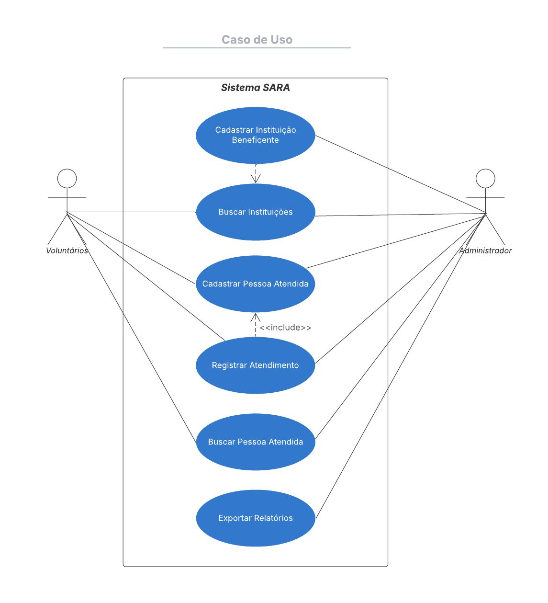
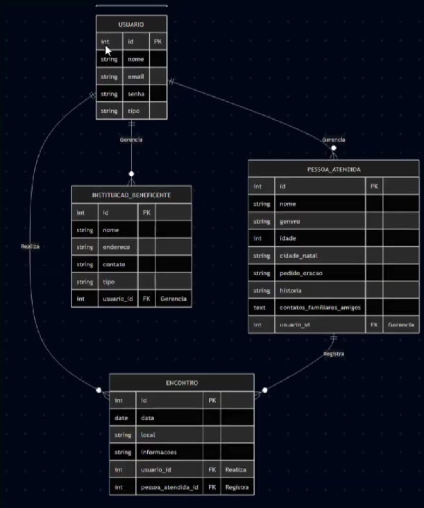
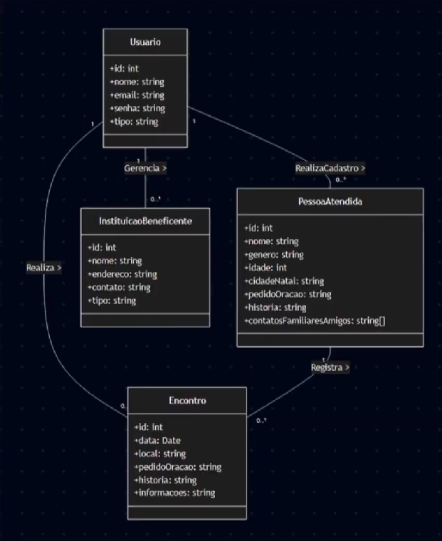

# Diagramas

Modelagem do sistema.

> Os diagramas mostram a modelagem completa do projeto. A versão atual implementa o cadastro de pessoas e encontros; usuários, instituições beneficentes e relatórios ainda estão por vir.

## Caso de uso

Dois atores usam o sistema: **voluntários** e **administrador**. Os dois buscam instituições, cadastram e buscam pessoas atendidas e registram atendimentos. Cadastrar instituições beneficentes e exportar relatórios fica só com o administrador. Registrar um atendimento inclui ter a pessoa atendida cadastrada.

## DER

Quatro entidades: `USUARIO`, `INSTITUICAO_BENEFICENTE`, `PESSOA_ATENDIDA` e `ENCONTRO`. O usuário gerencia instituições e pessoas atendidas e realiza encontros. Cada encontro é registrado para uma pessoa atendida, que pode ter vários encontros.

## Classes

As mesmas entidades vistas como classes (`Usuario`, `InstituicaoBeneficente`, `PessoaAtendida` e `Encontro`), com atributos e multiplicidades: um usuário cadastra várias pessoas e realiza vários encontros, e uma pessoa atendida tem vários encontros.

